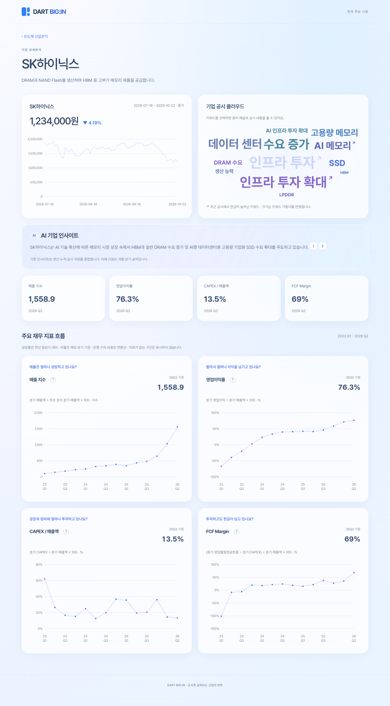

# DART BIG:IN

**공시로 읽는 산업의 흐름.** DART 전자공시 원문과 재무제표, KRX 시세를 하나로 엮어 산업과 기업의 변화를 보여주는 웹 서비스입니다.

AI가 쓴 모든 인사이트 문장에는 **실제 공시 원문 각주**가 달립니다. 각주를 누르면 근거가 된 사업보고서 문단과 표를 원문 그대로 확인할 수 있습니다.


## 무엇을 하나요

| 화면 | 보여주는 것 |
| --- | --- |
| **홈** | 자동차, 은행·금융지주, 헬스케어, 반도체, 철강 5개 산업을 KRX 지수 등락률과 함께 보여줍니다. |
| **산업 분석** | KRX 산업 지수 추이, 공시 신호 워드클라우드, AI 산업 인사이트, 대표 5개 기업의 재무 지표 비교를 제공합니다. |
| **기업 분석** | 주가, 기업 공시 키워드, AI 기업 인사이트, 분기별 매출·영업이익률·CAPEX·FCF 추이를 제공합니다. |

| 산업 분석 (반도체) | 기업 분석 (SK하이닉스) |
| --- | --- |
|  |  |

## 핵심 기능

### 1. 근거가 검증된 AI 인사이트
- 질문을 **BGE-M3**로 임베딩하고, MySQL에 저장된 약 14.7만 개 공시 청크 벡터와 코사인 유사도를 비교해 근거 후보를 고릅니다.
- **Gemini**가 문장마다 후보 근거를 직접 뒷받침(F), 이해 도움(U), 맥락 명확성(C), 시점 부합(T) 기준으로 평가합니다. 점수 기준을 통과한 근거가 있는 문장만 화면에 남깁니다.
- 서버는 생성 결과에서 다음을 다시 검증합니다. 근거가 없거나 검증에 실패한 문장은 만들어내지 않고 버립니다.
  - 인용한 문장 ID가 실제 입력에 있는지
  - 원문 위치가 맞는지
  - 문장에 나온 금액과 수치가 재무 데이터와 일치하는지

### 2. 공시 원문 각주 뷰어
- 각주는 `chunk_id`, `document_id`, 원본 XML 순서로 연결됩니다. 원본 XML은 SHA-256과 크기를 확인한 뒤 안전한 HTML로 렌더링합니다.
- 근거 문단은 강조 표시하고, 표는 원본 구조를 복원해서 보여줍니다. DART 원문 링크도 함께 제공합니다.
- XML 파싱은 외부 엔티티와 네트워크 접근을 차단합니다. 복원한 결과가 원문 텍스트와 다르면 표시하지 않습니다.

### 3. 공시 신호 워드클라우드
- 공시 본문에서 **Kiwi** 형태소 분석으로 명사와 복합어를 뽑습니다. 사업의 내용, 경영진단, 연구개발 섹션이 대상입니다.
- 키워드 점수는 언급 수준 50%, 연도별 변화 30%, 기업 간 확산 20%를 합산합니다. 여기서 특정 기업 쏠림과 일반 경영 표현은 감점합니다.
- 최근 언급이 급증한 키워드에는 ↗ 표시가 붙습니다. 키워드를 누르면 용어 설명과 관련 공시가 열립니다.

### 4. 재무 지표 비교
- 매출 지수, 영업이익률, CAPEX/매출액, FCF Margin을 분기 단위로 계산해 보여줍니다.
- 표준화된 재무 데이터가 없는 기간은 원본 XML 재무제표에서 계정, 기간, 단위가 정확히 일치하는 값만 보완합니다. 확정할 수 없는 값은 추정하지 않고 결측으로 둡니다.

### 5. 시장 데이터
- KRX OpenAPI에서 산업 지수 종가와 구성종목 시가총액을 받아오고, 개별 기업 주가도 함께 수집합니다.
- 서버를 시작하면 백그라운드에서 갱신합니다. 수집에 실패하면 이전 데이터를 그대로 유지합니다.

## 아키텍처

```text
 ┌──────────────┐    ┌────────────────────────────┐    ┌──────────────────┐
 │  Web (SPA)   │───▶│  app.py  (Python HTTP API) │───▶│  MySQL 8         │
 │  HTML/CSS/JS │◀───│  /api/project, /api/source │◀───│  공시 청크·벡터  │
 │  SVG 차트    │    │  /api/keyword-filings ...  │    │  재무·원본 XML   │
 └──────────────┘    └─────────────┬──────────────┘    └──────────────────┘
                                   │
            ┌──────────────────────┼───────────────────────┐
            ▼                      ▼                       ▼
     BGE-M3 임베딩 +         Gemini (인사이트 ·        KRX / OpenDART
     NumPy 유사도 검색       근거 평가 · 용어 설명)    시세 · 공시 목록
```

분석은 두 단계로 나뉩니다.

1. **보고서 생성** (`snapdart.analyze`): 검색과 LLM 생성, 검증을 거쳐 보고서를 캐시에 저장합니다.
2. **화면 조회** (`app.py`): 저장된 보고서와 시세를 읽어서 응답합니다.

그래서 페이지를 열 때마다 LLM을 호출하지 않습니다.

## 기술 스택

| 영역 | 사용 기술 |
| --- | --- |
| Backend | Python 3.12, 표준 라이브러리 `http.server`(ThreadingHTTPServer), SQLAlchemy, PyMySQL |
| Database | MySQL 8.0 (공시 청크, BGE-M3 벡터, 표준화 재무, 원본 XML) |
| Retrieval | BGE-M3 (sentence-transformers), NumPy 코사인 유사도 |
| LLM | Google Gemini (구조화 JSON 출력, RPM/TPM 예산 관리, 병렬 생성) |
| NLP | Kiwi (kiwipiepy) 한국어 형태소 분석 |
| Parsing | lxml (안전 모드 XML 복구) |
| Data | DART OpenAPI, KRX OpenAPI, FinanceDataReader |
| Frontend | Vanilla JS (ES Modules), 직접 구현한 SVG 차트·워드클라우드, Pretendard |
| Test | unittest (Python), Node 기반 UI 테스트 |

## 프로젝트 구조

```text
app.py              웹 서버와 API 진입점
snapdart/           분석·검색·시세 명령, Gemini 요청, 화면 데이터 구성
dart_remote/        MySQL 조회, 벡터 검색, 근거 선택·검증, 원문 출처, 워드클라우드
config/sectors.json 산업별 표시 순서, 검색 주제, 용어
web/                화면 (index / industry / company + assets)
tests/              단위·UI 테스트
docs/               설계 문서 (docs/4차구상 이 현재 구현 설명)
```

## 실행 방법

> 서비스 데이터는 프로젝트용 MySQL 서버에 있습니다. 이 저장소만으로는 데이터를 조회할 수 없고, 접속 정보가 담긴 `.env`가 필요합니다.

```bash
python3.12 -m venv .venv
source .venv/bin/activate          # Windows: .venv\Scripts\activate
pip install -r requirements.txt

cp .env.example .env               # MySQL, Gemini, KRX, OpenDART 키 입력
python -X utf8 app.py --no-market-refresh
```

브라우저에서 http://127.0.0.1:8501 을 엽니다.

AI 분석 보고서를 다시 만들 때는 다음 명령을 씁니다.

```bash
python -X utf8 -m snapdart.analyze --llm --sector 반도체
```

테스트는 다음 명령으로 실행합니다.

```bash
python -B -X utf8 -m unittest discover -s tests -p "test_*.py"
```

## 문서

- [현재 구현 설명서](docs/4차구상/README.md): 데이터 조회부터 인사이트 생성, 화면 표시까지의 전체 파이프라인
- [개발 노트](docs/DEVELOPMENT.md): 기능별 상세 정책과 변경 이력

---

부트캠프 팀 미니 프로젝트로 시작한 서비스입니다. 공시·재무 데이터 적재 파이프라인은 팀원이 담당했고, 이 저장소에는 그 데이터 위에서 동작하는 서비스(백엔드와 웹)만 담았습니다.
