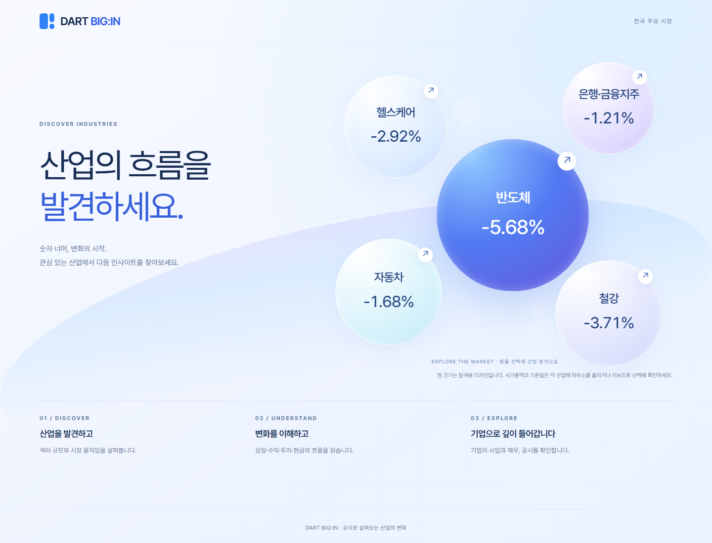
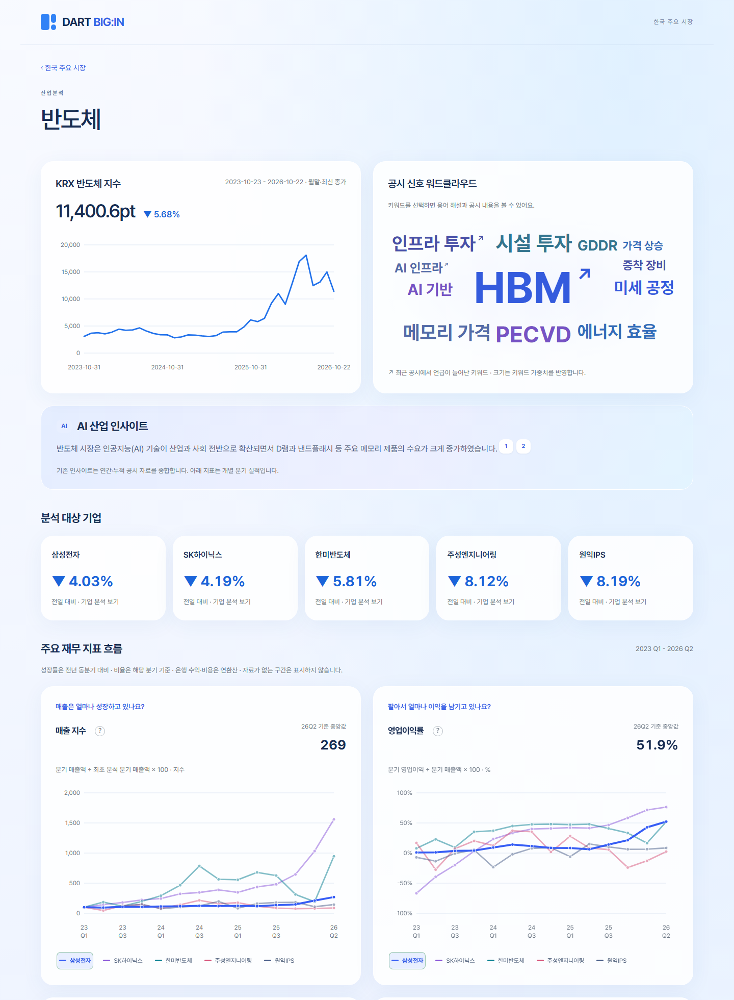

# DART BIG:IN

**공시로 읽는 산업의 흐름.** DART 전자공시 원문과 재무제표, KRX 시세를 하나로 엮어 산업과 기업의 변화를 보여주는 웹 서비스입니다.

AI가 쓴 모든 인사이트 문장에는 **실제 공시 원문 각주**가 달립니다. 각주를 누르면 근거가 된 사업보고서 문단과 표를 원문 그대로 확인할 수 있습니다.



## 내 역할

부트캠프 팀 프로젝트입니다. 이 중 **데이터 계층 전체**(파이프라인, DB 구축, 데이터 품질 점검·개선)와 **UI 개선**을 맡았습니다.

### 1. 공시·재무 데이터 파이프라인 ([pipeline/src](pipeline/src))
- **수집**: OpenDART API로 5개 산업 25개 기업의 2023~2025년 재무제표와 공시 원문(XML)을 수집합니다. 대상 보고서는 1분기, 반기, 3분기, 사업보고서입니다.
- **정제·표준화**: 기업마다 다른 계정명과 `account_id`를 24개 표준 계정으로 매핑합니다.
  - 분기 값과 누적 값을 구분해서 정규화합니다.
  - 단위를 통일하고, 부호 규칙(비용 계정 부호)을 보정합니다.
  - 공시 원문에서 직접 확인한 정정 값만 반영합니다.
- **은행업 별도 처리**: 은행업은 일반 기업과 재무제표 구조가 다릅니다. 표준화 데이터가 없는 구간은 원본 XML 재무제표에서 값을 추출해 보완했습니다.
- **청킹·임베딩**: 공시 본문을 섹션 단위로 나누고(청킹), BGE-M3 dense 벡터를 생성합니다. 그 결과 청크와 벡터가 각각 14.7만 개입니다.
- **검색 모델 선정**: 임베딩 모델별 검색 품질 벤치마크를 돌린 결과로 기본 검색을 Feature Hashing 하이브리드에서 BGE-M3 dense로 바꿨습니다. 기존 방식은 롤백용으로 남겨뒀습니다.

### 2. 데이터 품질 점검 및 개선 ([pipeline/src/quality](pipeline/src/quality))
DART API 값을 그대로 믿지 않고, **공시 원문(XML)과 다음 해 보고서의 전기 비교 수치를 근거로 저장값을 하나씩 대조**했습니다.

- **4,124건 전수 감사**: 미검증 재무 항목 4,124건을 판정했습니다.
  - 검증 완료 1,430건, 확정 오류 10건이 나왔습니다.
  - 오류 중에는 우리금융 2023년 4분기 신용손실비용이 **2조 1,572억 원 과대** 저장된 건이 있었습니다.
  - 확정 오류는 모두 보정했습니다.
- **은행 비용 지표 부호 표준화**: 같은 비용인데 공시마다 API 부호가 달라서, 회사 간·기간 간 비교가 불가능한 상태였습니다.
  - 5개 은행의 신용손실·이자·수수료 비용 360행을 손익계산서 근거로 판정했습니다. 근거는 소계 산술(총액 − 비용 = 순액)과 표시 방식입니다.
  - 부호가 잘못된 76행을 "양수 = 비용"으로 통일했습니다.
- **잔여 2,684건 원인별 정리**:
  - 원문에서 확인한 누락 분기값 1,397건은 새로 생성했습니다.
  - 잔액끼리 빼서 잘못 만든 현금흐름 "분기값" 553건은 제거했습니다.
  - 근거를 찾을 수 없는 값은 추정하지 않고 결측으로 두었습니다.
- **운영 원칙**:
  - 원천값(API 원값, 원본 XML)은 수정하지 않습니다. 보정은 별도 계층에 기록합니다.
  - 모든 보정은 staging DB에서 검증하고 테스트를 통과한 뒤에만 운영 버전으로 승격합니다.
  - 버전마다 sha256과 증적을 남겨서 언제든 롤백할 수 있습니다.
- 검증 스크립트 26개를 운영합니다. 계정 매핑 품질, 재무 회귀 검사, 검색 품질 벤치마크, BGE-M3와 FAISS 검색 결과 대조, 적재 후 스모크 테스트가 포함됩니다.

### 3. 중앙 MySQL DB 구축 ([pipeline/infra/mysql](pipeline/infra/mysql))
- 재무 데이터, 공시 청크, 임베딩, 원본 XML, KRX 지수를 담는 **스키마를 설계**했습니다.
- 표준화 재무 조회용 VIEW를 만들고, migration 8개로 스키마를 단계적으로 확장했습니다.
- **버전 관리 적재**: SQLite에서 만든 스냅샷을 MySQL에 upsert하고, 원본과 대조 검증합니다.
  - `data_versions` 테이블이 버전마다 원천 sha256, 검증 여부, 현재 버전 여부(`is_current`)를 관리합니다.
  - 검증을 통과한 버전만 서비스에 노출됩니다.
  - 활성 행이 1% 넘게 줄어드는 비정상 적재는 자동으로 막습니다.
- 계정을 **ETL용(읽기·쓰기)과 서비스용(읽기 전용)으로 분리**했습니다. 팀원들은 함께 배포한 클라이언트로 같은 DB를 조회합니다.

### 4. UI 개선 ([service/web](service/web))
- 홈 화면을 새로 디자인했습니다. 산업을 버블로 보여주고, 각 버블에 KRX 지수 등락률을 함께 표시합니다.
- 산업·기업 화면의 카드 레이아웃, 차트, 워드클라우드를 다듬고 Pretendard 기반 타이포그래피를 적용했습니다.

> 서비스 백엔드는 팀원이 구현했습니다. 데이터 검색, Gemini 인사이트 생성과 검증, 원문 각주 뷰어가 여기에 해당합니다. 아래 기능 설명에는 서비스 전체 모습을 이해할 수 있도록 함께 소개합니다.

## 화면

| 화면 | 보여주는 것 |
| --- | --- |
| **홈** | 자동차, 은행·금융지주, 헬스케어, 반도체, 철강 5개 산업을 KRX 지수 등락률과 함께 보여줍니다. |
| **산업 분석** | KRX 산업 지수 추이, 공시 신호 워드클라우드, AI 산업 인사이트, 대표 5개 기업의 재무 지표 비교를 제공합니다. |
| **기업 분석** | 주가, 기업 공시 키워드, AI 기업 인사이트, 분기별 매출·영업이익률·CAPEX·FCF 추이를 제공합니다. |

| 산업 분석 (반도체) | 기업 분석 (SK하이닉스) |
| --- | --- |
|  |  |

## 핵심 기능

- **근거가 검증된 AI 인사이트**
  - 질문을 BGE-M3로 임베딩하고, 공시 청크 벡터와 코사인 유사도를 비교해 근거 후보를 고릅니다.
  - Gemini가 문장마다 근거가 얼마나 잘 뒷받침하는지 평가합니다.
  - 서버가 결과를 다시 확인합니다. 인용 ID가 실제 입력에 있는지, 원문 위치가 맞는지, 금액이 재무 데이터와 일치하는지 봅니다. 근거가 없는 문장은 만들지 않습니다.
- **공시 원문 각주 뷰어**
  - 각주는 `chunk_id`, 원본 문서, 원본 XML 순서로 연결됩니다.
  - 원본 XML은 SHA-256과 크기를 확인한 뒤 안전하게 렌더링합니다.
  - 근거 문단은 강조 표시하고, 표는 원본 구조를 복원해서 보여줍니다.
- **공시 신호 워드클라우드**
  - Kiwi 형태소 분석으로 공시 본문에서 키워드를 추출합니다.
  - 점수는 언급 수준 50%, 연도별 변화 30%, 기업 간 확산 20%를 합산합니다.
- **재무 지표 비교**
  - 매출 지수, 영업이익률, CAPEX/매출액, FCF Margin을 분기 단위로 보여줍니다.
  - 확정할 수 없는 값은 추정하지 않고 결측으로 둡니다.
- **시장 데이터**
  - KRX OpenAPI에서 산업 지수와 구성종목 시가총액을, 별도로 기업 주가를 받아옵니다.
  - 서버를 시작하면 백그라운드에서 갱신합니다.

## 아키텍처

```text
            ── pipeline/ (데이터 계층) ──                         ── service/ (사용자 서비스) ──

 OpenDART ─▶ 수집 ─▶ 정제·계정 표준화 ─▶ SQLite         ┌──────────────┐    ┌──────────────────┐
             │                            │             │  Web (SPA)   │◀──▶│  app.py (API)    │
             └▶ 공시 XML ─▶ 청킹 ─▶ BGE-M3 임베딩         │  HTML/CSS/JS │    │  검색·Gemini·검증 │
                                          │             └──────────────┘    └────────┬─────────┘
                                          ▼                                          │ 읽기 전용
                               검증 ─▶ MySQL 8 (버전 관리 적재) ◀────────────────────────┘
```

두 계층은 MySQL로만 연결됩니다. 서비스는 읽기 전용 계정으로, 검증이 끝난 현재 버전(`data_versions.is_current`)만 조회합니다.

## 기술 스택

| 영역 | 사용 기술 |
| --- | --- |
| Data Pipeline | Python 3.12, pandas, OpenDART API, SQLite |
| Database | MySQL 8 (스키마, VIEW, migration, 계정 분리), Docker Compose |
| Embedding·Search | BGE-M3 (sentence-transformers), NumPy, FAISS (검증용) |
| Backend | Python `http.server`, SQLAlchemy, PyMySQL, Google Gemini, Kiwi, lxml |
| Frontend | Vanilla JS (ES Modules), 직접 구현한 SVG 차트·워드클라우드, Pretendard |
| Market Data | KRX OpenAPI, FinanceDataReader |

## 프로젝트 구조

```text
pipeline/                     데이터 계층 (수집 → 표준화 → 임베딩 → MySQL)
├─ src/collect, preprocess,   수집, 정제, 기간 정규화, 청킹
│  mapping, extract
├─ src/db                     재무 DB, CAPEX, 지표, KRX 지수, 정정 값 반영
├─ src/quality                품질 검증 스크립트
├─ src/retrieval              임베딩과 검색
├─ infra/mysql                스키마, migration, 동기화, 계정 설정
└─ docs/handoff               DB 스키마와 컬럼 사전, 인수인계 문서

service/                      사용자 서비스
├─ app.py                     웹 서버와 API
├─ snapdart/, dart_remote/    분석, 검색, LLM, 원문 출처, 워드클라우드
└─ web/                       프론트엔드
```

## 실행 방법

> 데이터는 프로젝트용 MySQL 서버에 있어서, 실행하려면 접속 정보가 담긴 `.env`가 필요합니다.

```bash
python3.12 -m venv .venv && source .venv/bin/activate
pip install -r pipeline/requirements.txt -r service/requirements.txt

# 서비스
cd service
cp .env.example .env               # MySQL, Gemini, KRX, OpenDART 키 입력
python -X utf8 app.py --no-market-refresh    # http://127.0.0.1:8501
```

파이프라인 실행 방법과 MySQL 구축 절차는 [pipeline/README.md](pipeline/README.md)와 [pipeline/infra/mysql/README.md](pipeline/infra/mysql/README.md)를 참고하세요.

## 문서

- [DB 스키마](pipeline/docs/handoff/DB_SCHEMA_20261011.md): 테이블 구조와 관계
- 품질 점검 보고서
  - [잔여 항목 정밀 검증](pipeline/docs/handoff/RESIDUAL_VERIFICATION_REPORT_20261009.md)
  - [은행 비용 부호 표준화](pipeline/docs/handoff/EXPENSE_SIGN_V9_STAGING_20261009.md)
  - [최종 정리(v10)](pipeline/docs/handoff/FINANCIAL_CLEANUP_V10_AND_2026_READINESS.md)
- [MySQL 중앙화 설계](pipeline/docs/handoff/MYSQL_CENTRALIZATION_PLAN.md): 중앙 DB 설계와 운영 방식
- [서비스 구현 설명서](service/docs/4차구상/README.md): 데이터 조회부터 인사이트 생성, 화면 표시까지
- [서비스 개발 노트](service/docs/DEVELOPMENT.md): 기능별 상세 정책과 변경 이력
